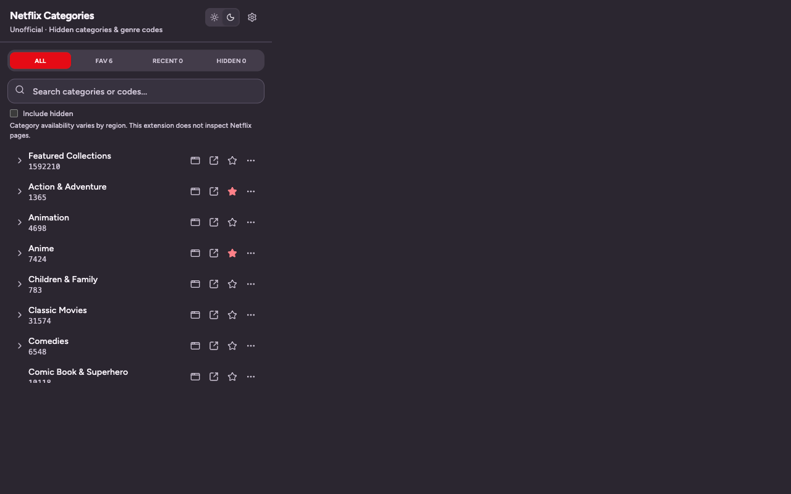
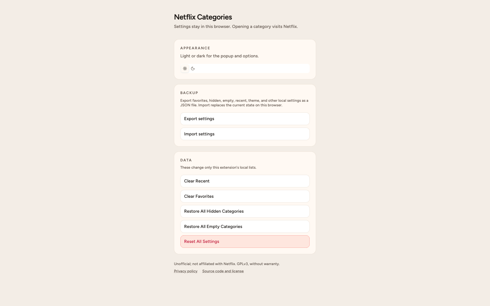

# Categories for Netflix (Unofficial)

An independent, open-source Chrome extension for searching public Netflix genre codes and keeping local category lists. Not affiliated with, endorsed by, or sponsored by Netflix.

## Install

[Add Categories for Netflix (Unofficial) to Chrome](https://chromewebstore.google.com/detail/categories-for-netflix-un/dhmkkdcngbedlfggdpdnoahebcdnmdlj). After installing, pin the extension to the toolbar for easy access.

## Features

- Search the bundled catalog by name or numeric code, without a remote category API.
- Open a category in the current tab or a new tab; copy its code or URL.
- Save favorites, hide categories, and view your last 10 extension selections.
- Export/import local settings as JSON and reset or restore lists in Options.
- Switch between light and dark themes.
- Restore empty-category markers from earlier settings exports. New empty-page detection is disabled.

The store build uses only the `storage` permission. It does not read Netflix pages, cookies, credentials, viewing history, or account information. Opening a link visits Netflix normally and still requires whatever subscription and regional access Netflix ordinarily requires. This extension does not unlock restricted titles or bypass payment, ads, DRM, or region limits.

## Screenshots

### Browse categories

Search by name or genre code, open category links, and keep favorites in the toolbar popup. Shown in dark theme with sample favorites.



### Settings

Choose a theme, export or import settings, and clear or restore local category lists. Shown in light theme.



See also the [search screenshot](docs/store-assets/02-search.png) and [favorites screenshot](docs/store-assets/03-favorites.png).

## Website

[netflix-categories.potion.sh](https://netflix-categories.potion.sh) is the landing page, with a searchable list of every genre code. It is built from the same dataset as the extension and lives in `apps/landing`.

## Repository layout

This is a Bun workspace monorepo, orchestrated with Turborepo.

```text
apps/extension/     # the Chrome extension (WXT + React), the code that ships to the store
apps/landing/       # the website (Astro + Tailwind + shadcn/ui), deployed to Vercel
packages/categories # the bundled genre dataset, shared by both apps
docs/               # store submission, data provenance, and release notes
```

## Develop locally

Use Bun **1.4.2**, pinned in `package.json`. WXT and Astro also require Node.js 22 or newer.

```bash
git clone https://github.com/antick/netflix-categories-chrome.git
cd netflix-categories-chrome
bun install --frozen-lockfile
bun run build:extension
```

Open `chrome://extensions`, enable Developer mode, select **Load unpacked**, and choose `apps/extension/.output/chrome-mv3`. For development, `bun run dev` starts WXT's development browser, and `bun run dev:landing` serves the website at `http://127.0.0.1:4321`.

```bash
bun run validate:data     # check the shared dataset
bun run check             # Biome lint and format check across the repo
bun run typecheck         # both apps
bun run test              # extension unit tests and website build checks
bun run build:extension
bun run validate:release  # store package permission and notice checks
bun run zip               # apps/extension/.output/netflix-categories-chrome-<version>-chrome.zip
bun run build:landing     # apps/landing/dist
```

`bun run check:fix` applies safe Biome fixes; `bun run format` formats files. CI runs the extension and website checks as separate workflows, each only when its files change.

## Releases

A release is a GitHub Release tagged `v<version>` at a commit on `main`, matching `apps/extension/package.json`'s version. Publishing it does two things:

- It is the corresponding GPLv3 source for the store ZIP of that version, which is still built and uploaded by hand. See the [store submission guide](docs/CHROME_WEB_STORE_SUBMISSION.md).
- It deploys the website to production through `.github/workflows/vercel-production.yml`. Merges to `main` alone never deploy. Run that workflow by hand to redeploy the latest release.

## Retained experimental integration

The injected Netflix header menu, its background registration code, and empty-page detection remain in the source for future consideration. `PAGE_INTEGRATION_ENABLED` in `apps/extension/lib/release.ts` is **false**. WXT excludes those entrypoints from the package, and the manifest includes no host, scripting, or active-tab permission. There is no enable control in the release UI; old stored preferences and imports cannot enable it.

Do not enable this for a store release without resolving Netflix's terms restrictions and repeating the security, permission, privacy, and store review. The current release validation intentionally fails if it is enabled. The experimental code is not certified for use merely because its unit tests pass. Historical images in `docs/screenshots/` show the earlier experimental UI and are not current store assets.

## Data and privacy

The catalog is bundled in `packages/categories/netflix-categories.json`. Availability varies by country and over time. See [what the data contains and where it came from](docs/CATEGORY_DATA.md), including the distinction between public category facts and potentially protected compilation material.

Preferences stay in local browser storage. Exports are ordinary unencrypted files on your device. Read the [privacy policy](PRIVACY.md) for data handling, deletion, and external links.

## Contributing and security

See [CONTRIBUTING.md](CONTRIBUTING.md) and [SECURITY.md](SECURITY.md). Never submit account cookies, credentials, private exports, or personal screenshots with an issue.

## License

Copyright (c) 2026 Pankaj. Project code is licensed under **GPL-3.0-only**; see [LICENSE](LICENSE). Distributed derivatives must retain notices and provide corresponding source under GPLv3. Compliant commercial forks and competing store listings are allowed. Earlier MIT-licensed copies retain their original permissions.

Third-party components and fonts retain their own licenses; see [THIRD_PARTY_NOTICES.txt](apps/extension/public/THIRD_PARTY_NOTICES.txt). The project license does not grant rights to Netflix trademarks or resolve third-party dataset rights. Use distinct branding for forks and do not imply endorsement.
